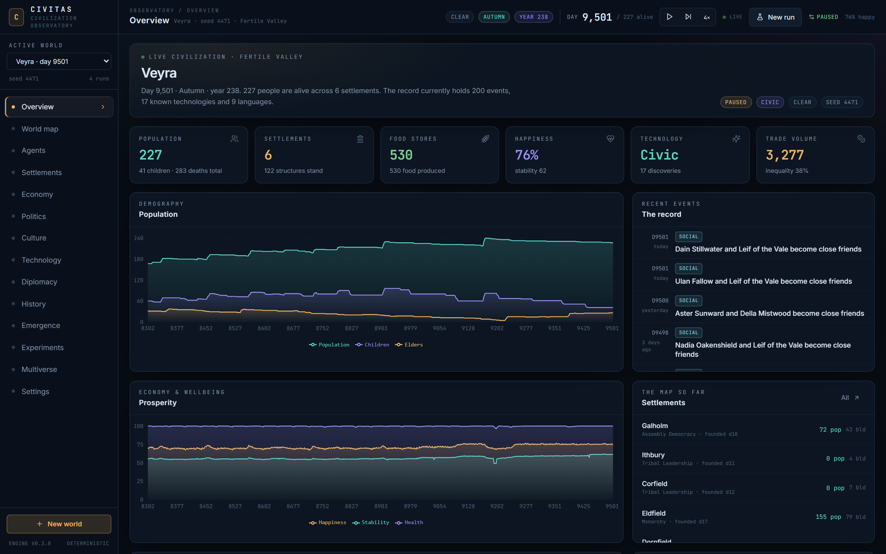
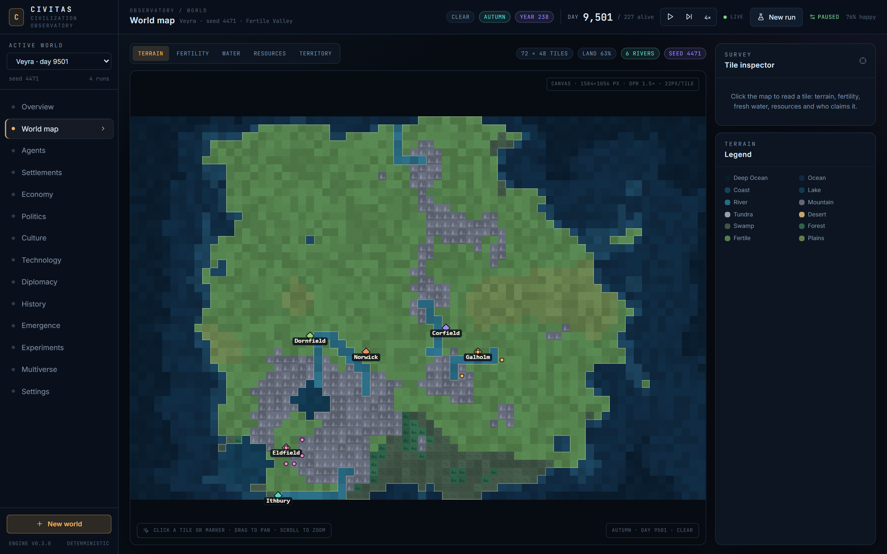
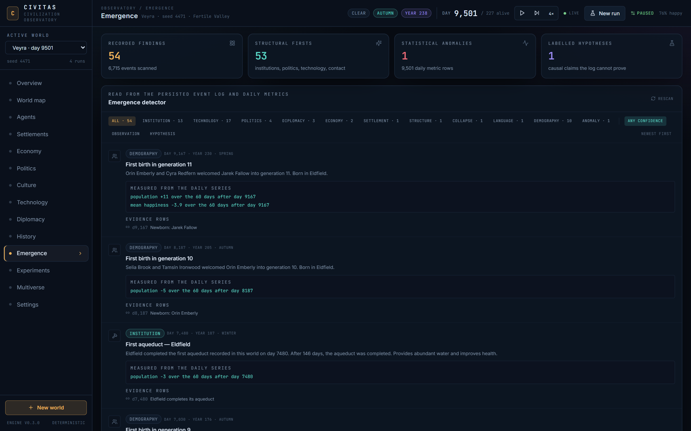
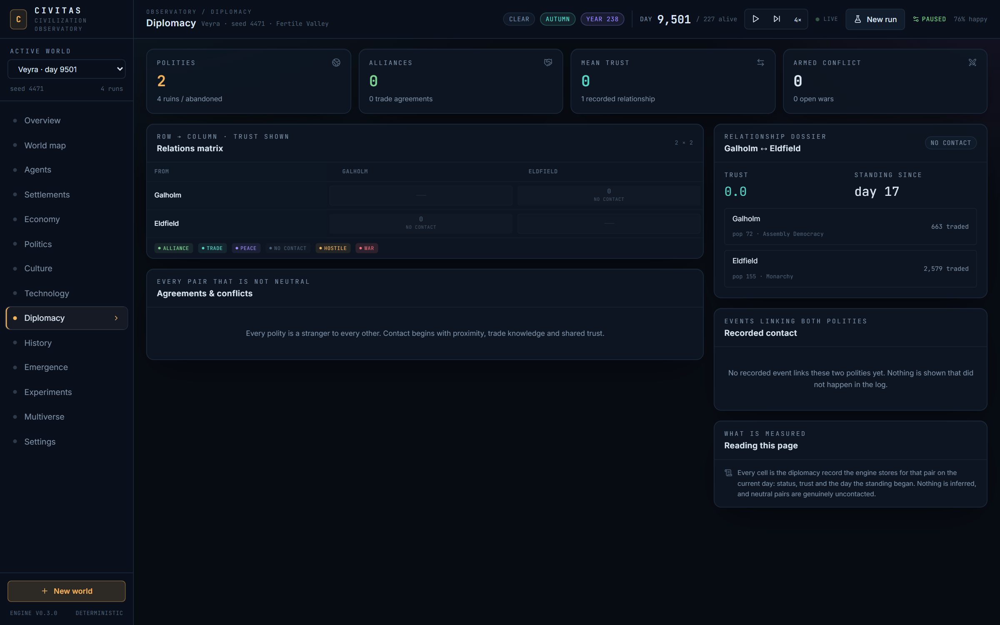
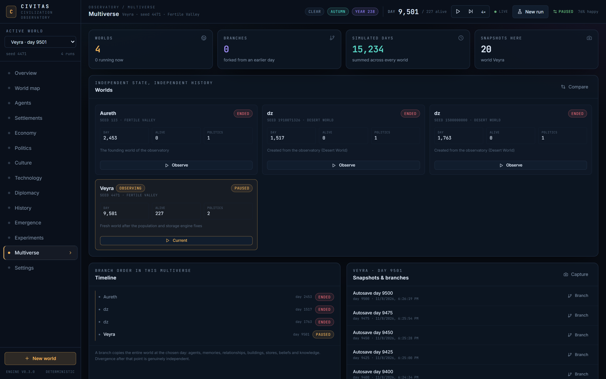

# CIVITAS — Autonomous Civilization Observatory

[](https://github.com/aimenmche/civitas/actions/workflows/ci.yml)
[](LICENSE)
[](https://www.python.org/)
[](https://react.dev/)
[](https://fastapi.tiangolo.com/)
[](https://www.sqlite.org/)

CIVITAS is a full-stack civilization simulator. You create a procedural world, seed it with a small population of autonomous agents, and watch them survive, gather, build, form relationships, found settlements, argue about laws, invent technologies, speak languages, raise families and die. Every event is produced by the simulation; nothing is scripted.



## Screenshots

| World map — device-pixel canvas | Emergence detector — findings from the stored log |
|---|---|
|  |  |
| **Diplomacy — relations matrix and pair dossier** | **Multiverse — worlds, snapshots and branches** |
|  |  |

## Quick start

Requirements: **Python 3.12+**, **Node.js 20+**, and npm. Two terminals are required for development.

```bash
git clone https://github.com/aimenmche/civitas.git
cd civitas
```

### 1. Backend

```bash
cd backend
python -m venv .venv
```

Activate the virtual environment, then install and run:

```powershell
# Windows (PowerShell)
.\.venv\Scripts\Activate.ps1
pip install -r requirements.txt
python -m uvicorn app.main:app --reload --port 8000
```

```bash
# macOS / Linux
source .venv/bin/activate
pip install -r requirements.txt
python -m uvicorn app.main:app --reload --port 8000
```

The API is now at `http://127.0.0.1:8000/api`. Interactive docs: `http://127.0.0.1:8000/docs`.

### 2. Frontend

In a second terminal:

```bash
cd frontend
npm install
npm run dev
```

Open **http://localhost:5173**. Vite proxies `/api` (including WebSockets) to port 8000.

### Production-style single server

```bash
cd frontend
npm run build
cd ../backend
python -m uvicorn app.main:app --port 8000
```

Then open `http://127.0.0.1:8000`. The backend serves `frontend/dist` when it exists.

## What you can do

- **Create worlds** with five presets, a fixed or random seed, climate, population, starting groups, scarcity, personality mix, starting knowledge and social constraints (no currency, no leader, asymmetric groups).
- **Watch live** through a WebSocket feed: pause, resume, step one day, and choose 0.25×–4× speed.
- **Explore the map**: a device-pixel-exact `<canvas>` terrain renderer (not a bitmap scaled by CSS) with pan/zoom, fertility, water, resources and territory overlays. Tiles stay sharp at native and 4K resolutions; SVG is used only for markers and labels. Click agents and settlements.
- **Inspect people**: needs, personality, skills, inventory, current decision and rationale, relationships, kin, memories, research, wealth and influence.
- **Inspect settlements**: stores, buildings and construction queues, government, laws, factions, diplomacy, market prices, culture, language and civic history.
- **Read history**: every event is persisted with day, year, season, participants, location, consequences and importance; filter by category and search it.
- **Trace diplomacy**: a relations matrix between living polities, with status, trust, the day a standing began, a pair dossier and every recorded event that links the two.
- **Run the emergence detector**: a scanner reads the persisted event log and daily metric series and reports structural firsts (institutions, technologies, laws, leaders, contact, war, language splits, generations) plus statistical anomalies. Measured consequences are raw differences between recorded days; causal readings are labelled hypotheses.
- **Use the time machine**: save a snapshot, then branch the entire world from that exact day. Branches preserve all agents, memories, relationships, buildings and knowledge.
- **Visit the multiverse**: every world and branch in one timeline, indented by ancestry, with snapshot capture, branch-from-snapshot and cross-run comparison.
- **Run experiments**: compare up to six runs on population, food, settlements, technology, happiness and inequality.
- **Optional chronicler**: a manually triggered language-model call retells recorded facts. It never runs during ticks, cannot mutate the simulation, and is disabled by default.

## Architecture

```
backend/
  app/
    sim/                 pure simulation engine
      world.py           procedural terrain, climate, resources, disasters
      agent.py           person state, needs, memory, relationships
      decision.py        utility scoring over candidate actions
      engine.py          daily phases, needs, demography, metrics, snapshots
      engine_actions.py  movement, gathering, eating, building, markets
      engine_social.py   encounters, trust, courtship, families, language contact
      engine_civ.py      settlement production, research, politics, culture
      settlement.py      buildings, storage, government, economy
      tech.py            technology graph and real effects
      culture.py         cultures and emergent lexicons
    services/runtime.py  live run manager, persistence, WebSockets
    services/emergence.py structural-firsts and anomaly scanner over stored rows
    api/routes.py        REST + WebSocket API
    models.py            SQLAlchemy tables
    main.py              FastAPI app and static frontend serving
frontend/
  src/
    components/          map, charts, event feed, inspectors, layout
    pages/               overview, world, agents, settlements, economy,
                         politics, culture, technology, diplomacy, history,
                         emergence, experiments, multiverse, settings
    store.ts             Zustand orchestration and live payload handling
```

### Simulation model

- **One tick = one day.** 10-day seasons, 40-day years. Daily phases: weather/disasters → decisions/actions → social encounters → settlement production → politics/culture → demography → metrics.
- **Deterministic.** A custom PRNG seeded from the world seed and the day. The same seed, config and step count produce identical state. This is covered by tests.
- **Rule-based agents.** Each living agent scores candidate actions from needs, personality, skills, inventory, relationships, settlement stores and long-term goals. The best action executes; the ranked alternatives and a short rationale are stored on the agent.
- **No LLM dependency.** The simulation runs completely offline. The optional chronicler only turns already-recorded events into prose on explicit request.
- **Persistence.** SQLite by default (`backend/data/civitas.db`). Runs, events, daily metrics and snapshots are stored in relational tables; full engine snapshots are JSON blobs used for restore and branching. The ORM also accepts a PostgreSQL URL through `CIVITAS_DATABASE_URL` (not verified end-to-end; see [Honest limitations](#honest-limitations)).
- **Live server loop.** The FastAPI process owns the simulation clock. Runs tick server-side at their configured speed and broadcast tick payloads over `/api/ws/runs/{run_id}`. Closing the browser does not pause the world.

## World presets

| Preset | Character |
|---|---|
| Fertile Valley | Temperate, river-rich, forgiving. Good for growth and towns. |
| Island Civilization | Fragmented land; travel and trade matter. |
| Desert World | Scarce water and forage; oases become strategic. |
| Frozen Continent | Cold, exposure and short growing seasons. |
| Random World | Land, mountains and moisture drawn from the seed. |

## Configuration

Environment variables (prefix `CIVITAS_`, optional `.env` in `backend/`; see `backend/.env.example`):

| Variable | Default | Meaning |
|---|---|---|
| `CIVITAS_DATABASE_URL` | `sqlite:///…/backend/data/civitas.db` | SQLAlchemy URL; PostgreSQL accepted by the ORM |
| `CIVITAS_CORS_ORIGINS` | localhost:5173 | comma-separated browser origins |
| `CIVITAS_API_KEY` | unset | if set, WebSocket connections require `?api_key=` |
| `CIVITAS_SNAPSHOT_INTERVAL_DAYS` | 25 | automatic snapshot cadence (newest 20 kept) |
| `CIVITAS_AUTOSAVE_INTERVAL_DAYS` | 25 | full-state autosave cadence |
| `CIVITAS_LLM_ENABLED` | false | enable the manual chronicler |
| `CIVITAS_LLM_BASE_URL` | OpenAI | any OpenAI-compatible chat-completions endpoint |
| `CIVITAS_LLM_API_KEY` | unset | provider key |
| `CIVITAS_LLM_MODEL` | gpt-4o-mini | narrative model name |

The chronicler is the only LLM feature. It is explicitly provider-independent (OpenAI-compatible HTTP), rate-limited, and cannot affect the world state.

## API

| Method | Path | Purpose |
|---|---|---|
| GET | `/api/health` | service status |
| GET | `/api/runs` | list archived/live runs |
| POST | `/api/runs` | create a world |
| GET | `/api/runs/{id}` | summary + full state |
| DELETE | `/api/runs/{id}` | delete run and cascaded history |
| POST | `/api/runs/{id}/control` | pause / resume / step / speed |
| GET | `/api/runs/{id}/state` | complete live state |
| GET | `/api/runs/{id}/world` | tile grid and overlays |
| GET | `/api/runs/{id}/agents` | agent summaries |
| GET | `/api/runs/{id}/agents/{agent_id}` | full dossier |
| GET | `/api/runs/{id}/settlements` | settlement summaries |
| GET | `/api/runs/{id}/settlements/{sid}` | full settlement record |
| GET | `/api/runs/{id}/technology` | technology tree and progress |
| GET | `/api/runs/{id}/events` | persisted events with filters |
| GET | `/api/runs/{id}/metrics` | daily metric series |
| GET | `/api/runs/{id}/history` | in-memory historical view |
| GET | `/api/runs/{id}/emergence` | structural firsts and metric anomalies from stored rows |
| GET/POST | `/api/runs/{id}/snapshots` | list / create snapshots |
| POST | `/api/runs/{id}/branch` | branch from current state or a snapshot |
| POST | `/api/experiments/compare` | compare 2–6 runs |
| POST | `/api/runs/{id}/chronicle` | optional narrative enrichment |
| WS | `/api/ws/runs/{id}` | live state and tick stream |

## Tests and continuous integration

```bash
cd backend
python -m pytest -q
cd ../frontend
npm run typecheck
npm run build
```

The suite covers deterministic replay, world generation, long-run survival without exceptions, snapshot restore equivalence, the emergence scanner's calendar and metric-difference rules, and the main REST flow.

GitHub Actions runs the same checks on every push and pull request to `main` (`.github/workflows/ci.yml`): backend tests on Python 3.12 and a frontend typecheck plus production build on Node 20.

## Honest limitations

- **SQLite is the verified default.** PostgreSQL support exists in the ORM and URL normalisation, but no local PostgreSQL instance or Docker daemon was available during development, so it is not end-to-end verified here. Redis is not used by this MVP.
- **Nothing beyond SQLite is implemented.** There is no Redis cache, no pgvector or embedding store, no Docker image, no Alembic migration chain (tables are created from SQLAlchemy metadata at startup) and no background job queue. Those are documented gaps, not hidden features.
- **Conflicts are rare.** Fertile worlds largely produce cooperation; warfare and coercion exist in the rules but are not a reliable spectacle. Harsher presets and scarcity make them more likely.
- **The UI is desktop-first.** It is responsive enough to shrink, but the map and side inspectors are designed for a wide screen.
- **Map interaction** is pan, zoom, overlays and click-selection. There is no tile painting or direct agent command — the premise is observation, not god-mode control.
- **LLM use is deliberately manual.** This avoids non-determinism, cost and hidden scripted outcomes. If no provider is configured, the chronicler returns a clear "unavailable" message and everything else works.
- **Emergence findings are descriptive, not explanatory.** The detector reports first occurrences and outliers read directly from stored event and metric rows. Its measured lines are raw day-to-day differences, and every causal reading is explicitly labelled a hypothesis. It does not establish why a change happened, and it caps output at the earliest 100 findings by day.
- **Narrative prose is minimal in the simulation itself.** Event descriptions are generated from real state and numbers; they are not literary fiction. The optional chronicler is the only prose layer.

## License

MIT — see [LICENSE](LICENSE).
